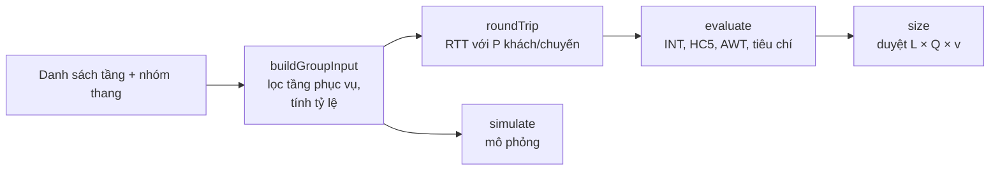

# 2. Thuật toán tính giao thông thang máy

Mã nguồn: [`app/js/engine.js`](../app/js/engine.js)

Phần này giải thích cách ArchiLift tính RTT, INT, HC5, AWT. Phương pháp dựa trên **CIBSE Guide D** và sách **Elevator Traffic Handbook (Barney)**, mở rộng để tính theo **cao độ thực** của từng tầng.

Cuối tài liệu có **ví dụ tính tay** với dự án mẫu để bạn tự đối chiếu.

---

## 2.0. Ý tưởng chung

Bài toán là giờ cao điểm buổi sáng (**cao điểm lên**): mọi người vào nhà từ sảnh hoặc tầng hầm và đi lên tầng của mình. Ta hỏi:

1. Một cabin đi một vòng mất bao lâu? → **RTT**
2. Có L cabin thì bao lâu có một chuyến? → **INT = RTT / L**
3. Trong 5 phút chở được bao nhiêu người? → **HC5**
4. Như vậy có đủ cho số người cần đi không? → so với **tiêu chí** và **nhu cầu**

Một vòng chạy gồm ba phần thời gian:

```
RTT = thời gian chạy (đi lên + về)  +  thời gian tổn thất ở mỗi lần dừng  +  thời gian khách ra/vào
```



---

## 2.1. Chuẩn bị dữ liệu nhóm — `buildGroupInput`

Với mỗi nhóm thang, chương trình làm các bước sau:

1. **Tính cao độ** mỗi tầng (`computeElevations`): cộng dồn chiều cao từ dưới lên, lấy tầng cốt làm mốc 0.
2. **Lọc các tầng nhóm có dừng.** Dân số của tầng trong nhóm = dân số tầng × % phân bổ.
3. **Chia tầng thành hai loại:**
   - **Ga vào** (Ga vào % > 0): tỷ lệ của mỗi ga `p = ga vào % / tổng ga vào % của nhóm`.
   - **Tầng phía trên** (có dân số, không phải ga vào): tỷ lệ `u = dân số tầng / tổng dân số nhóm`. Đây là xác suất một khách muốn đi đến tầng đó.
4. **Khoảng cách tầng trung bình** `d_f = (cao độ tầng trên cùng − cao độ tầng dưới cùng có dân số) / (số tầng − 1)`.
5. **Ghi cảnh báo** nếu một tầng vừa là ga vào vừa có dân số, hoặc có ga vào nằm cao hơn tầng có dân số.

---

## 2.2. Thời gian chạy giữa hai điểm — `flightTime`

Cabin không chạy ngay với vận tốc tối đa mà tăng tốc êm theo hình **chữ S**: độ giật `j` làm gia tốc tăng dần đến `a`, gia tốc làm vận tốc tăng dần đến `v`, rồi giảm tốc ngược lại.

Thời gian chạy quãng `d` (m) chia ba trường hợp:

| Trường hợp | Điều kiện | Công thức |
|---|---|---|
| Quãng dài: đạt được vận tốc định mức `v` | d ≥ v²/a + v·a/j | t = d/v + v/a + a/j |
| Quãng vừa: đạt gia tốc `a` nhưng chưa tới `v` | 2a³/j² ≤ d < v²/a + v·a/j | Tìm vận tốc đỉnh v_p từ v_p² + (a²/j)·v_p − a·d = 0, rồi t = 2·(v_p/a + a/j) |
| Quãng rất ngắn: chưa kịp đạt gia tốc `a` | d < 2a³/j² | t = 4·∛(d / 2j) |

Nếu `a²/j > v` (cabin đạt `v` trước khi kịp đạt `a`), chương trình hạ `a` xuống `√(v·j)`.

> Dễ hiểu: với quãng dài, thời gian = "chạy đều hết quãng" cộng một khoản phụ `v/a + a/j` cho phần tăng/giảm tốc.

---

## 2.3. Thời gian một vòng chạy — `roundTrip`

Gọi **P** là số khách trung bình trên mỗi chuyến. Khi tính **năng lực**, P = CC × 80% (1000 kg: 13 × 0,8 = 10,4 người).

### Bước 1 — Số lần dừng phía trên, S

Mỗi khách chọn tầng đến ngẫu nhiên theo tỷ lệ dân số u_i. Xác suất **không ai** trong P khách xuống tầng i là (1 − u_i)^P. Vậy:

```
S = Σ [ 1 − (1 − u_i)^P ]      (cộng trên mọi tầng phía trên)
```

Dùng tỷ lệ dân số thật của từng tầng nên tầng đông người có khả năng phải dừng cao hơn.

### Bước 2 — Cao độ đảo chiều kỳ vọng, H

Cabin quay đầu ở tầng cao nhất mà có khách xuống. Gọi F_i là tỷ lệ dân số cộng dồn từ dưới lên đến tầng i. Xác suất mọi khách đều xuống ở tầng ≤ i là F_i^P. Do đó:

```
H = Σ z_i · ( F_i^P − F_(i−1)^P )      (z_i = cao độ tầng i, mét)
```

Vì dùng **cao độ thật** chứ không đếm số tầng, công thức tự xử lý được tầng cao không đều và **vùng chạy thẳng** (nhóm thang bỏ qua các tầng thấp).

### Bước 3 — Phía ga vào: S_E và L_b

Tính tương tự cho các ga vào (sảnh, hầm), theo tỷ lệ "Ga vào %":
- **S_E** = số ga vào kỳ vọng mà cabin phải dừng đón khách.
- **L_b** = cao độ thấp nhất kỳ vọng mà cabin phải xuống tới (âm nếu là hầm).

Khi chỉ có **một sảnh**, S_E = 1 và L_b = cao độ sảnh, tức quay về đúng công thức CIBSE cổ điển.

### Bước 4 — Thời gian tổn thất mỗi lần dừng, t_s

Mỗi lần dừng tốn thêm thời gian so với chạy thẳng qua:

```
t_s = t_f(d_f) − d_f / v  +  t_o + t_c + t_sd
      └─ chậm vì tăng/giảm tốc ┘   └ mở, đóng cửa, trễ khởi hành ┘
```

### Bước 5 — Cộng lại

```
RTT = 2·(H − L_b)/v   +   (S + S_E)·t_s   +   2·P·t_p
      └ chạy lên + về ┘   └ tổn thất dừng ┘   └ P khách vào + P khách ra ┘
```

---

## 2.4. Các chỉ số từ RTT

| Chỉ số | Công thức | Giải thích |
|---|---|---|
| INT | RTT / L | L cabin chia đều một vòng |
| HC5 | 300 · P · L / RTT | Số chuyến trong 300 giây × số khách mỗi chuyến |
| %HC5 | HC5 / dân số nhóm × 100 | |
| AWT | [0,4 + (1,8·P/CC − 0,77)²] · INT | Công thức thực nghiệm Barney, đúng trong khoảng tải 50–80%. Dưới 50% chương trình dùng mức 50% |
| ATT | 0,5·(H − L_b)/v + 0,5·S·t_s + P·t_p | Trung bình khách đi nửa quãng đường và gặp nửa số lần dừng |
| AJT | AWT + ATT | |

---

## 2.5. Điểm làm việc theo nhu cầu

Phép tính năng lực giả định cabin luôn chở 80%. Thực tế ở giờ cao điểm, số khách mỗi chuyến **phụ thuộc** vào lượng người đến:
- Người đến nhiều → mỗi chuyến chở nhiều hơn → nhiều lần dừng hơn → RTT dài hơn → càng chở nhiều người mỗi chuyến.
- Hệ sẽ ổn định ở điểm mà **số người đến trong một INT bằng số người một chuyến chở đi**.

Gọi λ là số người đến mỗi giây, `λ = nhu cầu% × dân số / 300`. Ta cần tìm P sao cho:

```
P = λ · RTT(P) / L
```

**Cách giải: chia đôi (bisection).**
1. Xét hàm f(P) = λ·RTT(P)/L − P.
2. Nếu f(CC) > 0, tức ngay cả khi cabin chở đầy 100% vẫn không kịp, thì kết luận **Quá tải**.
3. Ngược lại, chia đôi khoảng (0, CC] 60 lần để tìm P. Vì RTT tăng chậm dần theo P nên phương trình chỉ có **một nghiệm**.
4. Tính lại INT, AWT… tại P vừa tìm. **Hệ số tải tại nhu cầu** = P / CC và phải ≤ 80%.

---

## 2.6. Đánh giá Đạt / Không đạt — `evaluate`

Trước khi tính, chương trình kiểm tra lỗi: nhóm phải phục vụ ít nhất một tầng có dân số và một ga vào; tải trọng phải đủ ít nhất 1 người; v, a, j phải > 0.

Một nhóm **Đạt** khi **tất cả** các kiểm tra sau đều đạt:

| Kiểm tra | Tính ở | Điều kiện |
|---|---|---|
| HC5 | Năng lực (tải 80%) | %HC5 ≥ tiêu chí |
| INT | Năng lực (tải 80%) | INT ≤ tiêu chí |
| Hệ số tải | Nhu cầu | Không quá tải **và** P/CC ≤ 80% |
| AWT (nếu nhập tiêu chí) | Nhu cầu | AWT ≤ tiêu chí |

---

## 2.7. Chọn thang tự động — `size`

Thuật toán **duyệt vét cạn** mọi tổ hợp, với mặc định 12 × 12 × 12 = 1.728 tổ hợp, chạy dưới 0,2 giây:

```
với mỗi số cabin L = 1 … 12:
  với mỗi tải trọng Q trong danh sách:
    với mỗi vận tốc v trong danh sách:
      đánh giá nhóm với (L, Q, v)  →  giữ lại nếu Đạt
      (và thời gian chạy thẳng hết hành trình ≤ giới hạn, nếu có nhập)
sắp xếp: ít cabin → tải nhỏ → vận tốc thấp
```

Danh sách mặc định:
- **Tải trọng:** 450, 630, 800, 1000, 1050, 1150, 1275, 1350, 1600, 1800, 2000, 2500 kg
- **Vận tốc:** 1,0; 1,5; 1,6; 1,75; 2,0; 2,5; 3,0; 3,5; 4,0; 5,0; 6,0; 7,0 m/s

> ⚠️ Chương trình **không biết** tổ hợp nào hãng thực sự sản xuất, và giữ nguyên gia tốc/jerk ở mọi vận tốc. Nên nhập **vận tốc tối đa** hợp lý cho công trình, nếu không danh sách có thể gợi ý phương án như "1050 kg × 7 m/s" cho chung cư 30 tầng.

---

## 2.8. Ví dụ tính tay — dự án mẫu

Dự án mẫu (nút **Ví dụ**): chung cư 30 tầng nổi, 3 hầm.
- **Tầng hầm:** B1–B3, mỗi tầng cao 3,3 m, ga vào 10%.
- **Sảnh T1:** cao 4,5 m, ga vào 70%.
- **T2:** không có dân số.
- **T3–T30:** mỗi tầng cao 3,2 m, có 40 người. Tổng **1.120 người**.
- **Nhóm thang:** 6 cabin × 1000 kg × 2,5 m/s; a = 1,0; j = 1,5; t_o = 2; t_c = 3; t_sd = 0,5; t_p = 1,2.

| Bước | Tính | Kết quả |
|---|---|---|
| Số người/cabin | ⌊1000/75⌋ | CC = 13 |
| Khách mỗi chuyến | 13 × 0,8 | P = 10,4 |
| Khoảng cách tầng TB | (T30 − T3)/27 | d_f = 3,2 m |
| Thời gian chạy 1 tầng | quãng vừa: v_p ≈ 1,49 m/s | t_f ≈ 4,31 s |
| Tổn thất mỗi lần dừng | 4,31 − 3,2/2,5 + 2 + 3 + 0,5 | t_s ≈ 8,53 s |
| Số lần dừng phía trên | 28 tầng đều, u = 1/28 | S ≈ 8,82 |
| Số lần dừng ga vào | 3·[1 − 0,9^10,4] + [1 − 0,3^10,4] | S_E ≈ 3,00 |
| Cao độ đảo chiều | | H ≈ 87,74 m |
| Cao độ thấp nhất | | L_b ≈ −8,39 m |
| Thời gian chạy | 2 × (87,74 + 8,39) / 2,5 | ≈ 76,9 s |
| Tổn thất dừng | (8,82 + 3,00) × 8,53 | ≈ 100,8 s |
| Khách ra/vào | 2 × 10,4 × 1,2 | ≈ 25,0 s |
| **RTT** | | **≈ 202,6 s** |
| **INT** | 202,6 / 6 | **≈ 33,8 s** (≤ 60 → đạt) |
| **HC5** | 300 × 10,4 × 6 / 202,6 | **≈ 92,4 người = 8,25%** (≥ 7% → đạt) |
| Nhu cầu 7% | 0,07 × 1120 | 78,4 người/5 phút |
| Điểm làm việc | giải P = λ·RTT(P)/6 | P ≈ 7,45 → **tải 57%** (≤ 80% → đạt) |

Kết luận: **Đạt**. Nếu tăng nhu cầu lên 12% (134 người/5 phút, vượt năng lực tối đa khi cabin đầy), kết quả chuyển sang **Quá tải / Không đạt**.

> Nhận xét: S_E ≈ 3 nghĩa là mỗi chuyến cabin kỳ vọng xuống đón khách ở khoảng 3 ga vào (sảnh + 2 tầng hầm). Riêng phần ga vào cộng thêm khoảng 25 s vào RTT. Nếu thực tế tầng hầm có nhóm thang con thoi riêng, hãy đặt ga vào hầm = 0 cho nhóm chính.
