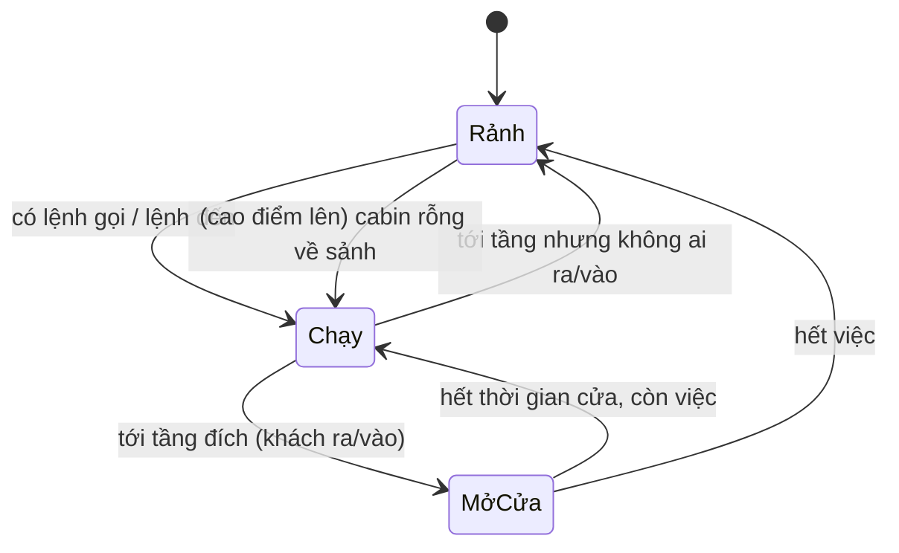

# 3. Mô phỏng vận hành nhóm thang

Mã nguồn: [`app/js/sim.js`](../app/js/sim.js)

Phần tính toán ở [tài liệu 2](02-tinh-toan-giao-thong.md) dùng **công thức trung bình**. Mô phỏng thì **cho chạy thử** nhóm thang với từng hành khách ảo, rồi **đo trực tiếp** thời gian chờ, thời gian đi và số người chở được. Nhờ vậy mô phỏng thấy được những điều công thức không cho thấy: phân bố thời gian chờ (bao nhiêu người chờ lâu), ùn tắc tích tụ theo thời gian, các kịch bản không phải cao điểm lên.

---

## 3.1. Bốn kịch bản giao thông

| Kịch bản | Đi vào (ga vào → tầng) | Đi ra (tầng → ga vào) | Giữa các tầng | Cabin rỗng về sảnh |
|---|---|---|---|---|
| Cao điểm lên (sáng) | 100% | 0% | 0% | Có |
| Cao điểm xuống (chiều) | 0% | 100% | 0% | Không |
| Hai chiều – giờ trưa | 45% | 45% | 10% | Không |
| Hỗn hợp | tự nhập | tự nhập | tự nhập | Không |

---

## 3.2. Các bước của mô phỏng

### Bước 1 — Sinh hành khách

- Khách đến ngẫu nhiên theo **quá trình Poisson**: khoảng cách giữa hai khách liên tiếp có phân bố mũ, trung bình `1/λ` giây, với `λ = cường độ% × dân số / 300` người/giây.
- Với mỗi khách, chương trình chọn loại chuyến đi theo tỷ lệ của kịch bản:
  - **Đi vào:** tầng đi chọn theo "Ga vào %", tầng đến chọn theo tỷ lệ dân số.
  - **Đi ra:** ngược lại.
  - **Giữa các tầng:** cả tầng đi và tầng đến đều chọn theo dân số, và phải khác nhau.
- Dùng bộ sinh số ngẫu nhiên có **hạt giống (seed)**: cùng seed thì cùng kết quả, giúp so sánh phương án công bằng.

### Bước 2 — Chạy theo bước thời gian 0,1 giây

Tại mỗi bước thời gian:
1. Khách mới đến tầng đi.
   - Nếu có cabin đang mở cửa ở đó, đúng chiều, còn chỗ và cửa chưa bắt đầu đóng → khách bước vào luôn.
   - Nếu không → khách xếp hàng chờ (hàng lên hoặc hàng xuống của tầng đó) và **gọi thang**.
2. Mỗi cabin ở một trong ba trạng thái:

   - **Chạy:** mất `t_f(quãng) + t_sd`, với t_f là thời gian chạy chữ S ở mục 2.2.
   - **Mở cửa:** mất `t_o + t_c + t_p × (số khách ra + số khách vào)`.
   - Cabin **không chở quá CC người** (số người định mức). Khách không lên được thì tiếp tục chờ và gọi lại.

### Bước 3 — Điều khiển nhóm thang

Đây là kiểu **điều khiển tập hợp hai chiều** (directional collective), phổ biến ở thang thông thường:

- **Giao lệnh gọi tầng:** khi có người gọi ở tầng f theo chiều d, chương trình ước tính mỗi cabin cần bao lâu để tới, rồi giao cho cabin **nhanh nhất**. Ước tính gồm:
  - thời gian cửa còn lại;
  - quãng đường cần chạy (nếu tầng gọi ngược chiều hoặc đã đi qua, cabin phải chạy hết chiều hiện tại rồi quay lại);
  - số lần dừng dọc đường × thời gian dừng trung bình;
  - **phạt** cabin đã đầy (+60 s) hoặc đang khá đông (tối đa +5 s).
- **Chọn hướng:** cabin giữ nguyên chiều đang đi nếu phía trước còn việc; hết việc mới đổi chiều.
- **Chọn điểm dừng kế tiếp:** điểm gần nhất phía trước theo chiều đi (tầng có khách muốn xuống, hoặc tầng gọi cùng chiều đã giao cho cabin). Lệnh gọi ngược chiều được phục vụ khi cabin quay đầu.
- **Đón lệnh gọi giữa đường** (công tắc, mặc định **bật**): xem bên dưới.
- **Về sảnh (cao điểm lên):** cabin rỗng, không còn việc thì tự chạy về ga vào chính.

#### Đón lệnh gọi giữa đường

Khi một lệnh gọi mới ở tầng k được giao cho cabin **đang chạy**, cabin đổi điểm dừng kế tiếp sang k nếu đủ cả bốn điều kiện:
1. k nằm **giữa** tầng xuất phát và điểm dừng đang nhắm tới;
2. lệnh gọi **cùng chiều** cabin đang đi;
3. cabin **còn chỗ**;
4. cabin **còn kịp hãm** theo đúng profile chữ S, tức thời gian đã chạy ≤ thời điểm chuyến ngắn (xuất phát → k) bắt đầu khác chuyến dài:

| Chuyến ngắn quãng d | Thời điểm tách nhau (tính từ lúc bắt đầu chuyển động) |
|---|---|
| Đạt vận tốc v | d / v (lúc bắt đầu hãm) |
| Đạt gia tốc a, chưa đạt v | v_p / a (lúc bắt đầu giảm gia tốc) |
| Chưa đạt a | T / 4 |

Trong thời gian trễ khởi hành t_sd, cabin chưa chuyển động nên đổi được sang mọi tầng phía trước. Sau khi đổi, thời gian còn lại = `t_f(xuất phát → k) + t_sd − thời gian đã trôi`. Ước tính thời gian tới khi giao lệnh gọi cũng tính đến khả năng này. Kiểm tra bằng tích phân số profile chữ S cho thấy thời điểm tách nhau khớp công thức.

Tắt công tắc thì cabin chỉ chọn điểm dừng **lúc khởi hành** (cách làm trước đây). Lệnh gọi phát sinh ở tầng giữa đường không được đón trong chuyến đó, nên kết quả hai chiều hơi **bi quan**. Ví dụ dự án mẫu, 8 giờ, hai chiều 50/50 ở 7%: WT 38,4 → 32,0 s và LW > 90 s 11,1 → 7,5% khi bật. Cao điểm lên gần như không đổi.

### Bước 4 — Kết thúc và thống kê

- Ngừng sinh khách sau `khởi động + thời gian đo`. Mô phỏng tiếp tục chạy cho đến khi chở hết người, tối đa thêm 1 giờ.
- WT, TT, DT, IS, LW chỉ thống kê khách đến **sau giai đoạn khởi động**, để bỏ ảnh hưởng của lúc mọi cabin còn rỗng.
- P5 (HC5 thực) đếm **mọi khách được chở tới đích** trong giai đoạn đo, kể cả khách gọi thang lúc khởi động (P5 = 5n/T của ISO 8100-32). Trước đây chỉ đếm khách đến sau khởi động nên P5 bị thấp ở hai đầu giai đoạn đo (lượt 30 phút ở 7%: thấp 4–9%).
- Khách chưa được đón khi mô phỏng dừng thì thời gian chờ tính đến thời điểm dừng.

### Bước 5 — Chạy nhiều lần

`simulateRuns` chạy N lần với hạt giống `seed, seed + 7919, seed + 2×7919…`, rồi báo **trung bình** và **khoảng min–max** của từng chỉ số. Biểu đồ dùng số liệu gộp của mọi lần chạy.

---

## 3.3. Các chỉ số đầu ra

| Chỉ số | Cách đo |
|---|---|
| WT (chờ) | Lúc vào cabin − lúc gọi thang |
| TT (trong cabin) | Lúc tới đích − lúc vào cabin |
| DT (tới đích) | Lúc tới đích − lúc gọi thang = WT + TT |
| P50, P90, P95 | Phân vị: ví dụ 90% khách có thời gian chờ ≤ P90 |
| LW | % khách chờ > 60 s và > 90 s (ngưỡng ISO 8100-32 / Schindler) |
| IS | Số lần cabin dừng giữa tầng lên và tầng đích (không tính lần mở lại cửa tại cùng tầng) |
| HC5 thực (P5) | Chia giai đoạn đo thành các khung 5 phút, đếm số khách **tới đích** trong mỗi khung (mọi khách), lấy trung bình và lớn nhất |
| Số người chờ theo thời gian | Lấy mẫu mỗi 10 s. Nếu đường **đi lên liên tục** thì nhóm thang không theo kịp (ùn tắc) |
| AWT theo tầng | Thời gian chờ trung bình theo tầng xuất phát; cột đỏ = > 60 s |
| Số lần dừng / cabin / giờ | Đo mức độ làm việc của cabin |

---

## 3.4. Đọc kết quả thế nào

- **Cường độ thấp hơn năng lực:** HC5 thực ≈ cường độ nhập, số người chờ dao động quanh một mức thấp → *Hệ thống đáp ứng*.
- **Cường độ vượt năng lực:** HC5 thực đạt trần (năng lực bão hòa), số người chờ tăng dần, WT rất lớn, có khách chưa được phục vụ → *Nguy cơ ùn tắc*.

Một lượt chạy bị coi là **ùn tắc** nếu có một trong ba dấu hiệu:
1. hơn 2% khách chưa được phục vụ khi kết thúc;
2. P5 < 95% nhu cầu sinh ra;
3. số người chờ trung bình ở 1/4 cuối giai đoạn đo gấp hơn 2 lần 1/4 đầu (và hơn 10 người) — hàng chờ đang phình ra.

Có một lượt ùn tắc là hiện *Nguy cơ ùn tắc*. Ngưỡng 95% (không dùng 98%) để lượt ngắn 30 phút không bị báo nhầm: thử 40 hạt giống ở mức 7% đều không báo nhầm.

Với dự án mẫu ở 7%, AWT mô phỏng (≈ 18 s) và ATT mô phỏng (≈ 81 s) **cao hơn** số ước tính bằng công thức (≈ 13 s và ≈ 56 s). Lý do: công thức không tính thời gian khách đã vào cabin nhưng còn phải đợi cabin dừng đón ở các ga vào khác. Khi cần số chờ/số đi chi tiết, nên ưu tiên số mô phỏng.

> **Lưu ý:** trong mô phỏng cabin được chở **đầy 100% CC**, còn phần tính năng lực giả định **80%**. Vì vậy HC5 thực lúc bão hòa và HC5 tính toán đo hai điều kiện khác nhau. Ví dụ dự án mẫu, cao điểm lên quá tải 12%, 8 giờ: HC5 thực ≈ 9,1%, HC5 tính 8,25%.

---

## 3.5. Quét nhiều mức nhu cầu

Báo cáo Schindler giữ mức nhu cầu **không đổi** trong mỗi lượt chạy, rồi chạy lại ở nhiều mức để tìm giới hạn phục vụ. Nút **Quét nhu cầu** ở tab 5 làm đúng như vậy:

1. Nhập danh sách mức nhu cầu (% dân số/5 phút), ví dụ `4, 5, 6, 7, 8, 9, 10, 11, 12`.
2. Mỗi mức chạy `Số lần chạy` lượt, giữ nguyên kịch bản, tỷ lệ vào/ra/giữa tầng, thời gian đo, khởi động, hạt giống và công tắc đón giữa đường. Chỉ thay cường độ.
3. Mỗi lượt được xét ùn tắc theo ba dấu hiệu ở mục 3.4. Trạng thái của một mức:
   - *Đáp ứng*: không lượt nào ùn tắc;
   - *Bất ổn k/n*: chỉ một số lượt ùn tắc — đã sát giới hạn, hàng chờ có những đợt phình rất lớn;
   - *Ùn tắc*: mọi lượt ùn tắc.
4. **Giới hạn phục vụ** = mức cao nhất mà nó và mọi mức thấp hơn đều *Đáp ứng*. Dòng đó được tô vàng, kèm P5 tương ứng.

Bảng kết quả có các cột giống báo cáo Schindler: P5, HC5 %, WT, DT, IS, LW > 90 s (thêm WT P90 và LW > 60 s). Hai biểu đồ cột cho WT và LW > 90 s theo mức nhu cầu, cột đỏ là mức ùn tắc/bất ổn.

Ví dụ dự án mẫu (6 × 1000 kg × 2,5 m/s), hai chiều 45/45/10, 8 giờ × 2 lượt, đón giữa đường bật: WT 36 s ở 7%, 78 s ở 10%; mức 11% *bất ổn 1/2* (1 trong 2 lượt ùn tắc) (WT 218 s, P90 729 s); mức 12% *ùn tắc* (P5 126 so với nhu cầu 134 người/5 phút) → giới hạn phục vụ **10%**. Gần giới hạn WT tăng rất nhanh — **giới hạn phục vụ không có nghĩa là thời gian chờ chấp nhận được**. Chọn mức thiết kế theo tiêu chí WT/LW của dự án, không theo giới hạn phục vụ.

Thời gian chạy: 9 mức × 2 lượt × 8 giờ ≈ 3–5 s trên trình duyệt.
