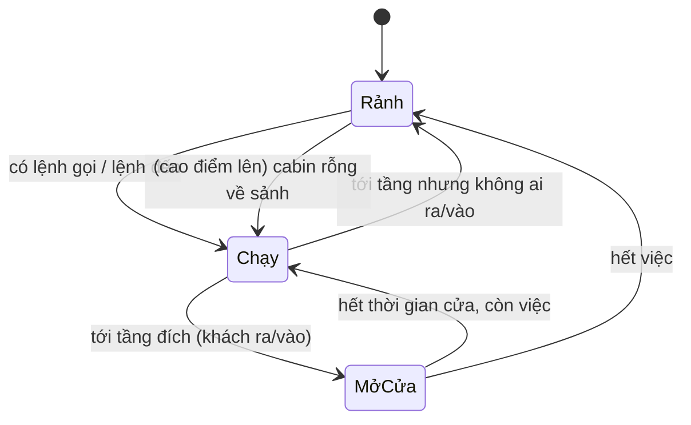

# 3. Mô phỏng vận hành nhóm thang

Mã nguồn: [`app/js/sim.js`](../app/js/sim.js)

Phần tính toán ở [tài liệu 2](02-tinh-toan-giao-thong.md) dùng **công thức trung bình**. Mô phỏng thì **cho chạy thử** nhóm thang với từng hành khách ảo, rồi **đo trực tiếp** thời gian chờ, thời gian đi và số người chở được. Nhờ vậy mô phỏng thấy được những điều công thức không cho thấy: phân bố thời gian chờ (bao nhiêu người chờ lâu), ùn tắc tích tụ theo thời gian, các kịch bản không phải cao điểm lên.

---

## 3.1. Bốn kịch bản giao thông

| Kịch bản | Đi vào (ga vào → tầng) | Đi ra (tầng → ga vào) | Giữa các tầng | Cabin rỗng về sảnh |
|---|---|---|---|---|
| Cao điểm lên (sáng) | 100% | 0% | 0% | Có |
| Cao điểm xuống (chiều) | 0% | 100% | 0% | Không |
| Hai chiều – giờ trưa | 45% | 45% | 10% | Không |
| Hỗn hợp | tự nhập | tự nhập | tự nhập | Không |

---

## 3.2. Các bước của mô phỏng

### Bước 1 — Sinh hành khách

- Khách đến ngẫu nhiên theo **quá trình Poisson**: khoảng cách giữa hai khách liên tiếp có phân bố mũ, trung bình `1/λ` giây, với `λ = cường độ% × dân số / 300` người/giây.
- Với mỗi khách, chương trình chọn loại chuyến đi theo tỷ lệ của kịch bản:
  - **Đi vào:** tầng đi chọn theo "Ga vào %", tầng đến chọn theo tỷ lệ dân số.
  - **Đi ra:** ngược lại.
  - **Giữa các tầng:** cả tầng đi và tầng đến đều chọn theo dân số, và phải khác nhau.
- Dùng bộ sinh số ngẫu nhiên có **hạt giống (seed)**: cùng seed thì cùng kết quả, giúp so sánh phương án công bằng.

### Bước 2 — Chạy theo bước thời gian 0,1 giây

Tại mỗi bước thời gian:
1. Khách mới đến tầng đi.
   - Nếu có cabin đang mở cửa ở đó, đúng chiều, còn chỗ và cửa chưa bắt đầu đóng → khách bước vào luôn.
   - Nếu không → khách xếp hàng chờ (hàng lên hoặc hàng xuống của tầng đó) và **gọi thang**.
2. Mỗi cabin ở một trong ba trạng thái:

   - **Chạy:** mất `t_f(quãng) + t_sd`, với t_f là thời gian chạy chữ S ở mục 2.2.
   - **Mở cửa:** mất `t_o + t_c + t_p × (số khách ra + số khách vào)`.
   - Cabin **không chở quá CC người** (số người định mức). Khách không lên được thì tiếp tục chờ và gọi lại.

### Bước 3 — Điều khiển nhóm thang

Đây là kiểu **điều khiển tập hợp hai chiều** (directional collective), phổ biến ở thang thông thường:

- **Giao lệnh gọi tầng:** khi có người gọi ở tầng f theo chiều d, chương trình ước tính mỗi cabin cần bao lâu để tới, rồi giao cho cabin **nhanh nhất**. Ước tính gồm:
  - thời gian cửa còn lại;
  - quãng đường cần chạy (nếu tầng gọi ngược chiều hoặc đã đi qua, cabin phải chạy hết chiều hiện tại rồi quay lại);
  - số lần dừng dọc đường × thời gian dừng trung bình;
  - **phạt** cabin đã đầy (+60 s) hoặc đang khá đông (tối đa +5 s).
- **Chọn hướng:** cabin giữ nguyên chiều đang đi nếu phía trước còn việc; hết việc mới đổi chiều.
- **Chọn điểm dừng kế tiếp:** điểm gần nhất phía trước theo chiều đi (tầng có khách muốn xuống, hoặc tầng gọi cùng chiều đã giao cho cabin). Lệnh gọi ngược chiều được phục vụ khi cabin quay đầu.
- **Về sảnh (cao điểm lên):** cabin rỗng, không còn việc thì tự chạy về ga vào chính.

> **Đơn giản hóa:** cabin chỉ chọn điểm dừng **lúc khởi hành**. Lệnh gọi mới phát sinh ở tầng nằm giữa đường không được đón trong chuyến đó. Với cao điểm lên ảnh hưởng không đáng kể; với giờ trưa hai chiều, kết quả hơi **bi quan** hơn thực tế.

### Bước 4 — Kết thúc và thống kê

- Ngừng sinh khách sau `khởi động + thời gian đo`. Mô phỏng tiếp tục chạy cho đến khi chở hết người, tối đa thêm 1 giờ.
- Chỉ thống kê khách đến **sau giai đoạn khởi động**, để bỏ ảnh hưởng của lúc mọi cabin còn rỗng.
- Khách chưa được đón khi mô phỏng dừng thì thời gian chờ tính đến thời điểm dừng.

### Bước 5 — Chạy nhiều lần

`simulateRuns` chạy N lần với hạt giống `seed, seed + 7919, seed + 2×7919…`, rồi báo **trung bình** và **khoảng min–max** của từng chỉ số. Biểu đồ dùng số liệu gộp của mọi lần chạy.

---

## 3.3. Các chỉ số đầu ra

| Chỉ số | Cách đo |
|---|---|
| WT (chờ) | Lúc vào cabin − lúc gọi thang |
| TT (trong cabin) | Lúc tới đích − lúc vào cabin |
| DT (tới đích) | Lúc tới đích − lúc gọi thang = WT + TT |
| P50, P90, P95 | Phân vị: ví dụ 90% khách có thời gian chờ ≤ P90 |
| LW | % khách chờ > 60 s |
| HC5 thực | Chia giai đoạn đo thành các khung 5 phút, đếm số khách **tới đích** trong mỗi khung, lấy trung bình và lớn nhất |
| Số người chờ theo thời gian | Lấy mẫu mỗi 10 s. Nếu đường **đi lên liên tục** thì nhóm thang không theo kịp (ùn tắc) |
| AWT theo tầng | Thời gian chờ trung bình theo tầng xuất phát; cột đỏ = > 60 s |
| Số lần dừng / cabin / giờ | Đo mức độ làm việc của cabin |

---

## 3.4. Đọc kết quả thế nào

- **Cường độ thấp hơn năng lực:** HC5 thực ≈ cường độ nhập, số người chờ dao động quanh một mức thấp → *Hệ thống đáp ứng*.
- **Cường độ vượt năng lực:** HC5 thực đạt trần (năng lực bão hòa), số người chờ tăng dần, WT rất lớn, có khách chưa được phục vụ → *Nguy cơ ùn tắc*.

Với dự án mẫu ở 7%, AWT mô phỏng (≈ 18 s) và ATT mô phỏng (≈ 81 s) **cao hơn** số ước tính bằng công thức (≈ 13 s và ≈ 56 s). Lý do: công thức không tính thời gian khách đã vào cabin nhưng còn phải đợi cabin dừng đón ở các ga vào khác. Khi cần số chờ/số đi chi tiết, nên ưu tiên số mô phỏng.

> **Lưu ý:** trong mô phỏng cabin được chở **đầy 100% CC**, còn phần tính năng lực giả định **80%**. Vì vậy HC5 thực lúc bão hòa và HC5 tính toán đo hai điều kiện khác nhau, không nên coi việc chúng gần bằng nhau là bằng chứng hai mô hình khớp.
