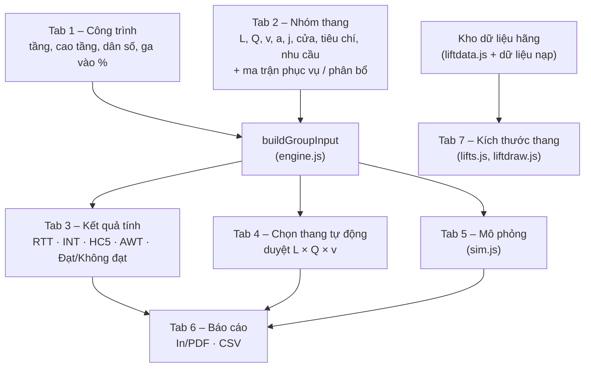

# Tài liệu kỹ thuật ArchiLift

ArchiLift là công cụ nội bộ của Archivina để **tính giao thông thang máy** và **tra kích thước hố thang theo hãng** ở giai đoạn Concept/TKCS. Ứng dụng viết bằng HTML + JavaScript thuần, chạy offline. Cách chạy xem [README dự án](../README.md).

## Mục lục

| # | Tài liệu | Đọc khi bạn muốn biết |
|---|---|---|
| 1 | [Dữ liệu đầu vào và kết quả đầu ra](01-dau-vao-dau-ra.md) | Phải nhập gì, mỗi chỉ số kết quả nghĩa là gì |
| 2 | [Thuật toán tính giao thông](02-tinh-toan-giao-thong.md) | RTT, INT, HC5, AWT được tính thế nào; ví dụ tính tay |
| 3 | [Mô phỏng vận hành](03-mo-phong.md) | Mô phỏng chạy ra sao, đọc biểu đồ thế nào |
| 4 | [Tra kích thước thang theo hãng](04-kich-thuoc-thang.md) | Cách chọn cấu hình hố/pit/OH và các kiểm tra |
| 5 | [Giới hạn và lưu ý](05-gioi-han-va-luu-y.md) | Giả định, điểm yếu đã biết, số liệu cần xác minh |
| — | [Nhật ký thay đổi](CHANGELOG.md) | Bản mới nhất đã đổi gì, đã kiểm tra những gì |

## Luồng xử lý tổng quát

## Bản đồ mã nguồn

| File | Nội dung | Tài liệu |
|---|---|---|
| `app/js/engine.js` | Động học cabin, RTT, điểm làm việc theo nhu cầu, chọn thang tự động | [2](02-tinh-toan-giao-thong.md) |
| `app/js/sim.js` | Mô phỏng theo bước 0,1 s | [3](03-mo-phong.md) |
| `app/js/lifts.js` | Chọn cấu hình theo hãng, kiểm tra giới hạn | [4](04-kich-thuoc-thang.md) |
| `app/js/liftdata.js` | Kho dữ liệu hãng (chỉ số liệu có nguồn) | [4](04-kich-thuoc-thang.md) |
| `app/js/liftdraw.js` | Hình vẽ SVG mặt bằng hố, mặt cắt pit/OH | [4](04-kich-thuoc-thang.md) |
| `app/js/charts.js` | Biểu đồ canvas | — |
| `app/js/app.js` | Giao diện, lưu/mở hồ sơ, báo cáo, chú giải | [1](01-dau-vao-dau-ra.md) |

## Ký hiệu thường gặp

| Ký hiệu | Nghĩa | Đơn vị |
|---|---|---|
| L | Số cabin trong nhóm | cabin |
| Q | Tải trọng định mức | kg |
| CC | Số người định mức = ⌊Q/75⌋ | người |
| P | Số khách trung bình mỗi chuyến | người |
| v, a, j | Vận tốc, gia tốc, độ giật (jerk) | m/s, m/s², m/s³ |
| t_o, t_c, t_sd, t_p | Mở cửa, đóng cửa, trễ khởi hành, mỗi khách ra/vào | s |
| t_f(d) | Thời gian chạy quãng d | s |
| t_s | Thời gian tổn thất mỗi lần dừng | s |
| S, S_E | Số lần dừng kỳ vọng phía trên / ở các ga vào | lần |
| H, L_b | Cao độ đảo chiều kỳ vọng cao nhất / thấp nhất | m |
| d_f | Khoảng cách tầng trung bình | m |
| RTT | Thời gian một vòng chạy | s |
| INT | Khoảng cách giữa các chuyến = RTT/L | s |
| HC5 | Năng lực vận chuyển 5 phút | người/5 phút, % |
| AWT, ATT, AJT | Thời gian chờ, trong cabin, tổng hành trình (trung bình) | s |
| WT, TT, DT, LW | Các đại lượng tương ứng đo trong mô phỏng; LW = % chờ > 60 s (và > 90 s theo ISO 8100-32) | s, % |
| IS | Số lần dừng giữa tầng lên và tầng đích (mô phỏng) | lần |
| P5 | Số khách được chở trong 5 phút, đo trong mô phỏng (= HC5 thực) | người/5 phút |
| BB × DD | Rộng × sâu cabin | mm |
| LL | Rộng cửa thông thủy | mm |
| WW × WD | Rộng × sâu hố thang | mm |
| PH, OH | Sâu pit, chiều cao tầng trên cùng | mm |
| CH, HH | Chiều cao cabin, chiều cao cửa | mm |

*Cập nhật: 19/11/2026.*
